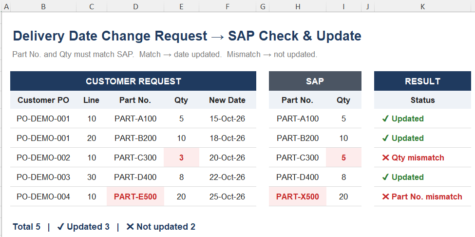

# SAP Delivery Date Automation

**SAP ERP/ECC | Excel VBA | SAP GUI Scripting | Order Management**

**Automated high-volumes Sales Order delivery date change** using **two methods**—**by Line Item** and **by Part Number**—reducing a **40+ minute manual process to ~10 minutes**.

---

## Business Problem

Delivery date change requests could involve **100+ line items**, requiring each item to be manually located, checked, and updated in SAP.

A large request could take **more than 40 minutes** to process, with repetitive manual updates increasing workload and the risk of errors.

---

## Solution

I developed two Excel VBA automations using SAP GUI Scripting to process delivery date changes.

### Method 1 — By Line Item

For requests containing a Line Item reference, the automation:

1. Reads the Customer PO, Line Item, Part Number, Quantity, and New Delivery Date from Excel.
2. Locates the requested **Line Item in SAP ECC**.
3. Retrieves the SAP Part Number and Quantity.
4. Validates the Part Number and Quantity against the request.
5. Updates the delivery date in SAP ECC only when both values match.
6. Records the processing result in Excel.

### Method 2 — By Part Number

For requests using the Part Number as the item reference, the automation:

1. Reads the Customer PO, Part Number, and New Delivery Date from Excel.
2. Locates the corresponding **Part Number in SAP ECC**.
3. Updates the delivery date in SAP ECC for the matched material.
4. Records the processing result in Excel.

### Validation Control

The Line Item method verifies **Part Number and Quantity** before updating the delivery date.

**Match → Delivery Date Updated**  
**Mismatch → No Update**

---

## Business Impact

| Area | Before | After |
|---|---|---|
| Processing Time | 40+ minutes | ~10 minutes |
| High-Volume Requests | Manual updates for 100+ line items | Automated processing |
| Validation | Manual checking | Automated PN/Qty validation for Line Item method |

---

## Demo

The demo uses fictional data to illustrate the **Line Item method** and its Part Number / Quantity validation.

[View Demo Workbook](./demo/SAP_delivery_date_automation_demo.xlsx)

### Source Code

[View Line Item Automation](./src/SAP_delivery_date_by_line_item.bas)

[View Part Number Automation](./src/SAP_delivery_date_by_part_number.bas)

---

## Technologies

**SAP ERP/ECC | SAP GUI Scripting | Excel VBA | Order Management | Process Automation**

---

*Portfolio version — company, customer, order, and production data have been removed or replaced with fictional examples.*
