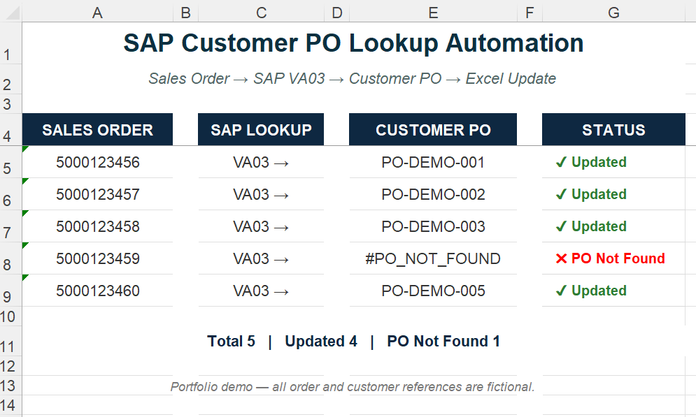

# SAP Customer PO Lookup & Excel Update Automation

**SAP ERP/ECC | Excel VBA | SAP GUI Scripting | Order Management**

**Automated Customer PO retrieval from SAP ECC** using Sales Order numbers, reducing repetitive SAP lookups and manual Excel updates during high-volume month-end reconciliation.

---

## Business Problem

Internal orders were tracked using **SAP Sales Order numbers**, while customers referenced orders using their own **Customer PO numbers**.

For month-end reconciliation, lists containing **100+ delivered orders** could require individual SAP lookups to retrieve Customer PO numbers and update Excel manually.

---

## Solution

I developed an Excel VBA automation using SAP GUI Scripting that:

1. Reads the Sales Order number from Excel.
2. Opens the Sales Order in SAP using **VA03**.
3. Retrieves the corresponding Customer PO number.
4. Updates the Customer PO directly in the correct Excel row.
5. Continues automatically through the remaining Sales Orders.

### Data Flow

**Excel Sales Order → SAP VA03 → Customer PO → Excel Update**

---

## Controls & Error Handling

- Existing Customer PO values are protected from overwrite.
- Sales Orders not found in SAP are marked as `#NOT_FOUND`.
- Missing Customer PO values are marked as `#PO_NOT_FOUND`.
- Processing errors are recorded as `#ERROR`.

---

## Business Impact

- Automated Customer PO lookup for high-volume month-end reconciliation.
- Reduced repetitive SAP lookups and manual Excel entry.
- Protected existing PO data and flagged missing records.

---

## Demo

[View Demo Workbook](./demo/SAP_customer_po_lookup_demo.xlsx)

[View VBA Source Code](./src/SAP_customer_po_lookup.bas)

---

## Technologies

**SAP ERP/ECC | SAP GUI Scripting | Excel VBA | Order Management | Process Automation**

---

*Portfolio version — company, customer, order, and production data have been removed or replaced with fictional examples.*
