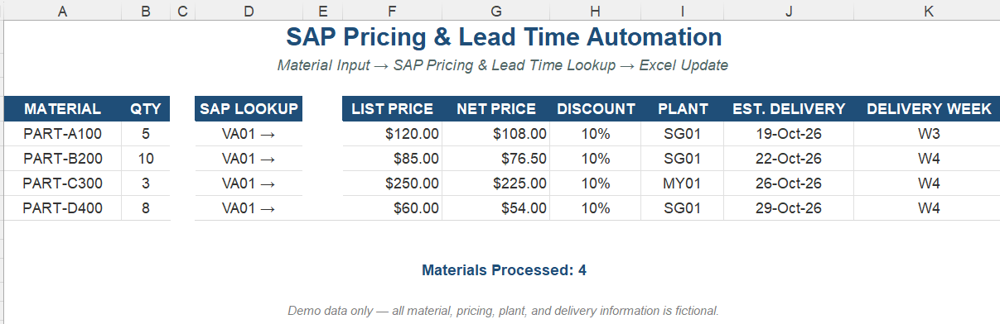

# SAP Pricing & Lead Time Automation

**SAP ERP/ECC | Excel VBA | SAP GUI Scripting | Order Management**

Automated pricing and lead time checks for multiple materials in SAP ECC, consolidating key pricing and delivery information directly into Excel.

---

## Business Problem

Pricing and delivery information had to be checked individually in SAP for each material.

When handling multiple materials, repeatedly checking **List Price, Net Price, Discount, Plant, and Estimated Delivery Date** required multiple SAP lookups and manual Excel updates.

---

## Solution

I developed an Excel VBA automation using SAP GUI Scripting that:

1. Reads Material and Quantity information from Excel.
2. Checks each material in SAP ECC.
3. Retrieves the relevant pricing and delivery information.
4. Updates the results directly in Excel.
5. Continues automatically through the remaining materials.

### Information Retrieved

- **List Price**
- **Net Price**
- **Discount**
- **Plant**
- **Estimated Delivery Date**

### Data Flow

**Excel Material List → SAP ECC → Pricing & Lead Time Check → Excel Update**

---

## Business Impact

- Reduced repetitive SAP pricing and delivery checks.
- Reduced manual Excel entry and consolidation.
- Consolidated pricing and estimated delivery information into a single Excel view.
- Supported more efficient processing of multi-material requests.

---

## Demo

[View Demo Workbook](./demo/SAP_pricing_lead_time_demo.xlsx)

[View VBA Source Code](./src/SAP_pricing_lead_time.bas)

---

## Technologies

**SAP ERP/ECC | SAP GUI Scripting | Excel VBA | Order Management | Process Automation**

---

*Portfolio version — company, customer, pricing, material, and production data have been removed or replaced with fictional examples.*
