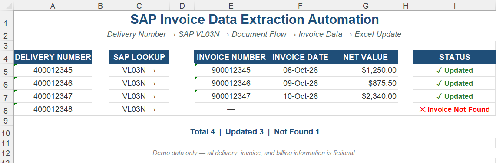

# SAP Invoice Data Extraction Automation

**SAP ERP/ECC | Excel VBA | SAP GUI Scripting | Order Management**

Automated invoice data retrieval from SAP ECC using Delivery Numbers, eliminating repetitive manual invoice lookups and Excel updates.

---

## Business Problem

Invoice details had to be manually traced from individual Delivery Numbers in SAP.

For larger delivery lists, repeatedly locating the related invoice and copying the information into Excel was time-consuming.

---

## Solution

I developed an **Excel VBA automation using SAP GUI Scripting** that:

1. Reads Delivery Numbers from Excel.
2. Locates the related Invoice through SAP Document Flow.
3. Retrieves **Invoice Number, Invoice Date, and Net Value**.
4. Updates the results automatically in Excel.
5. Continues through multiple delivery records and worksheets.

### Data Flow

**Excel Delivery Number → SAP VL03N → Document Flow → Invoice → Excel Update**

---

## Business Impact

- Reduced repetitive SAP invoice lookups.
- Automated processing of multiple Delivery Numbers.
- Reduced manual Excel entry.

---

## Demo

[View Demo Workbook](./demo/SAP_invoice_data_extraction_demo.xlsx)

[View VBA Source Code](./src/SAP_invoice_data_extraction.bas)

---

*Portfolio version — company, customer, delivery, invoice, and production data have been removed or replaced with fictional examples.*
