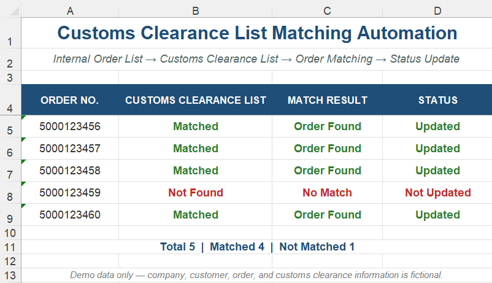
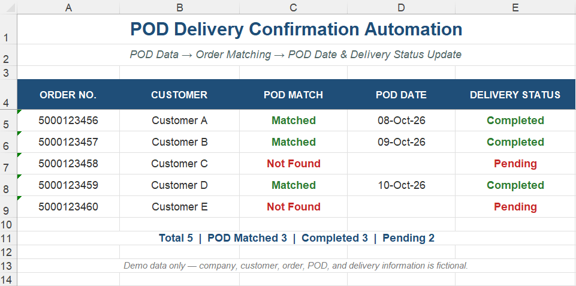

# Order Tracking & Delivery Status Automation

**Excel VBA | Order Management | Logistics Automation**

**Automated order tracking across multiple Excel files** by matching Customs Clearance and POD (Proof of Delivery) data with internal order lists and updating order and delivery information in Excel.

---

## Business Problem

Order status required manual comparison across multiple Excel files, making large order lists time-consuming to track and update.

---

## Solution

I developed two Excel VBA automations:

### 1. Customs Clearance Matching

Matches Sales Orders against the Customs Clearance List and **identifies matching orders automatically**.

### 2. POD Delivery Confirmation

Matches POD data with internal Order Numbers and automatically updates **POD Date and Delivery Status**.

---

## Data Flow

**Customs Clearance / POD Data → Order Matching → Status Update**

---

## Business Impact

- Reduced repetitive manual file comparison.
- Automated order matching and delivery status updates.
- Reduced manual Excel entry.

---

## Demo

### Customs Clearance Matching

[View Demo Workbook](./demo/Customs_clearance_matching_demo.xlsx) | [View Source Code](./src/Customs_clearance_matching.bas)

### POD Delivery Confirmation

[View Demo Workbook](./demo/POD_delivery_confirmation_demo.xlsx) | [View Source Code](./src/POD_delivery_confirmation.bas)

---

*Portfolio version — company, customer, order, customs clearance, POD, and delivery data have been replaced with fictional examples.*
