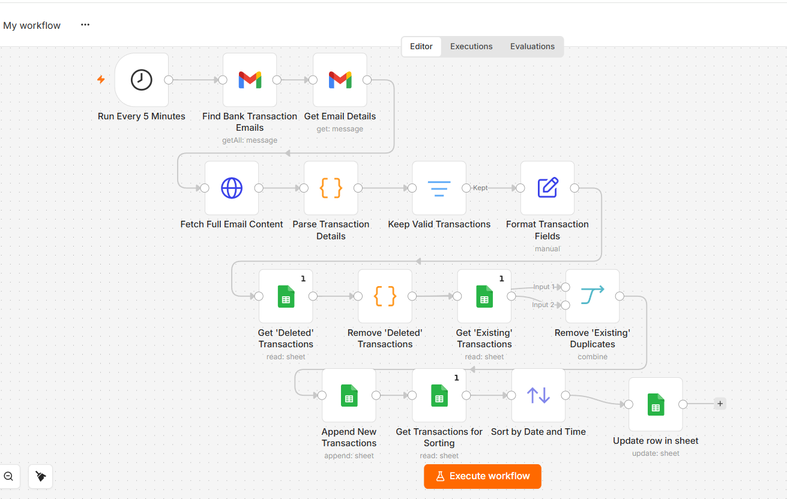
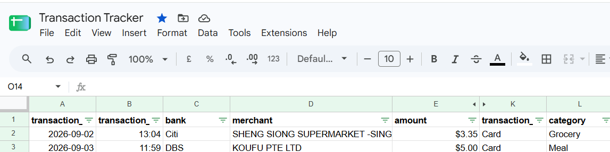
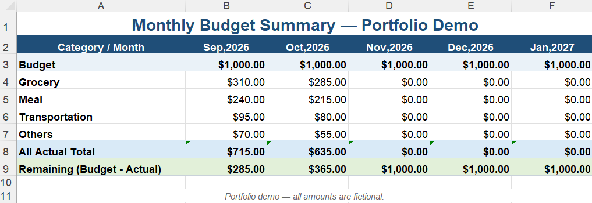

# n8n Personal Transaction Automation

**n8n | Gmail | Google Sheets | Workflow Automation**

**A self-initiated personal automation** project that processes transaction notification emails and organizes transaction data in Google Sheets for **monthly expense and budget tracking**.

---

## Why I Built This

Building Excel VBA automations for my work sparked my interest in broader process automation.

**After completing a two-day hands-on n8n course**, I applied what I learned by building this workflow for personal use and automating repetitive transaction tracking.

---

## Solution

The workflow automatically:

1. Retrieves transaction notification emails from Gmail.
2. Extracts and formats transaction details.
3. Filters invalid transactions.
4. Categorizes transactions using predefined rules.
5. Prevents duplicate records by checking existing and previously deleted transactions.
6. Updates new transactions in Google Sheets.
7. Sorts records by date and time.
8. Runs automatically on a scheduled basis.

### Workflow

### Data Flow

**Gmail → n8n → Extract & Process → Validate & Categorize → Duplicate Check → Google Sheets → Monthly Budget Tracking**

---

## Transaction Output

Processed transactions are automatically structured and categorized in Google Sheets.

---

## Monthly Expense & Budget Tracking

Transaction data is summarized into a simple monthly view showing:

**Budget → Grocery → Meal → Transportation → Others → Total Actual Spending → Remaining Budget**

---

## Impact

- Eliminated repetitive manual transaction entry.
- Created an automatically updated monthly expense and budget tracker.
- Applied newly learned n8n skills to a practical end-to-end workflow.
- Expanded my automation experience beyond Excel VBA and SAP GUI Scripting.

---

## Technologies

**n8n | Gmail | Google Sheets | Workflow Automation | Data Processing**

---

*Personal portfolio project — all financial, account, transaction, merchant, and personal data have been removed or replaced with fictional examples.*
